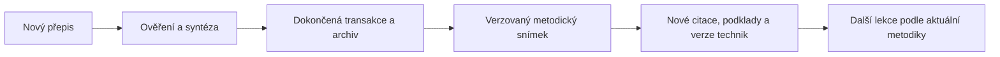

# Learning Ecosystem

Místní prostředí pro osvojování studijních technik Justina Sunga při skutečném
studiu vlastních předmětů. Spojuje čtyři skilly, evidenci výsledků, 22 tréninkových
oblastí a automaticky aktualizovanou metodickou knihovnu.

## Veřejná a soukromá verze

| Repozitář | Účel |
|---|---|
| `learning-ecosystem` | Veřejná prezentace kódu, skillů, dokumentace a testů se syntetickými daty. |
| `learning-ecosystem-private` | Soukromé pracovní prostředí se stejným kódem, vlastními materiály a studijním pokrokem. |

Soukromá verze přenáší materiály, výsledky předmětů, coaching, trénink studijních
technik a odpovídající metodické verze. Každé zařízení má vlastní Python prostředí
a přihlášení. Veřejná verze má samostatnou historii bez studijních dat.

Profil určuje `.github/repository-profile.json`. GitHub Actions jej porovnává se
skutečnou viditelností repozitáře a pro obě varianty spouští stejné testy.
Veřejná aktualizace vzniká exportem z commitnuté soukromé verze, nikdy sloučením
její historie. [Používání obou repozitářů](ecosystem/docs/repositories.md).

## Začátek používání

V tomto projektu napiš například:

```text
Veď mě při studiu TILO. Navazuj na moje uložené výsledky,
vyber jednu vhodnou Sungovu techniku a nech mě ji skutečně provést.
```

Projektový [AGENTS.md](AGENTS.md) směruje asistenta na místní kanonické skilly.
Učitel obnoví historii předmětu a kouč vybere další metodický krok. Nové materiály
výslovně přiřaď k předmětu; `source-add` je přesouvá do knihovny.

| Skill | Odpovědnost |
|---|---|
| [study-library](skills/study-library/SKILL.md) | Materiály, mapa učiva a přesné citace. |
| [study-tutor](skills/study-tutor/SKILL.md) | Výuka, vlastní odpovědi, zpětná vazba a přenos. |
| [study-progress](skills/study-progress/SKILL.md) | Historie skutečných výsledků po předmětech. |
| [study-coach](skills/study-coach/SKILL.md) | Volba techniky, plán, trénink a reflexe. |

Pro vedenou práci na semestrálním projektu PRF je navíc místní
[prf-project-mentor](skills/prf-project-mentor/SKILL.md). Pracuje s projektem
na místě určeném uživatelem a rozlišuje hotovou asistentskou implementaci od
vlastního výkonu studenta. Školní projekty jsou samostatné.

## Trénink a jeho evidence

Každá oblast má účel, zdrojové části, praktickou úlohu a pozorovatelná kritéria
v [registru technik](ecosystem/config/techniques.json). Postupuje se od vysvětlení
účelu přes vedené provedení ke dvěma samostatným různým pokusům, přenosu do jiné
situace a ověření s odstupem. Jde o pravidla pro shromažďování dokladů, nikoli
vědecky validovaný test nebo záruku zvládnutí.

Vystavení lekce, přečtení metodiky ani hotový výstup AI nezvyšují úroveň.
Známá pomoc a předchozí vidění řešení se evidují. Neuzavřené hodnocení zůstává
neuzavřené; oprava nevytváří nový pokus. [Průchod tréninkem](skills/study-coach/references/training.md).

```bash
.venv/bin/python -B ecosystem.py doctor
.venv/bin/python -B ecosystem.py subjects
.venv/bin/python -B ecosystem.py next --subject tilo
.venv/bin/python -B ecosystem.py status --subject tilo
.venv/bin/python -B ecosystem.py methods --technique priming
```

`doctor` hodnotí připravenost místního studia (`ready_scope: local-study`).
Pole `automation_access_last_check` ukazuje poslední uloženou kontrolu přístupu
ke Codexu; nenahrazuje nové síťové ověření. Příkaz `learning-knowledge access`
provádí živou kontrolu a zaznamenává její výsledek včetně případného pozastavení
automatizace, pokud přístup nelze potvrdit.

Datum opakování a plán slouží při další návštěvě. Automatické studijní
notifikace a nepřetržité sledování práce nejsou spuštěné.

## Automatická aktualizace po novém videu



Původní `update`, `run` i plánovaný běh po zpracování automaticky spouštějí
synchronizaci. Ta ověří stav a hash, vytvoří neměnný snímek, obnoví řádkové
odkazy, porovná dotčené techniky a atomicky zveřejní verzi. Skilly čtou aktuální
podklady. Změněné techniky dostanou příznak nového ověření; dosavadní pokusy
zůstávají u své původní verze.

Při chybě zůstává poslední platný snímek. Plánovač rozpozná nedokončenou
synchronizaci a zopakuje ji i při již zpracovaném přepisu. K přepočtu není
potřeba další modelové volání. Text videa nepřepisuje instrukce skillů ani
výsledky uživatele. [Podrobnosti](ecosystem/docs/operation.md).

## Umístění součástí

```text
learning_ecosystem/
  AGENTS.md                  Vstupní pravidla pro asistenta
  ecosystem.py               Přenositelný spouštěč
  skills/                    Čtyři kanonické skilly
                             a specializovaný mentor projektu PRF
  ecosystem/
    src/learning_ecosystem/   Synchronizace a trénink
    config/techniques.json   Úlohy a kritéria
    scripts/                 Dokončení přesunu a registrace skillů
    data/                    Studijní data a metodické verze — pouze soukromý Git
  knowledge_pipeline/        Přepisy, syntéza, archiv a týdenní plánovač
  tests/                     Testy tréninku a integrace
```

Název nadřazené složky řeší dokončovací skript níže. Python balíček
`learning_app.knowledge_pipeline` zachovává své dosavadní rozhraní.

## Instalace a dokončení přesunu

Čistý checkout vyžaduje Python 3.11+ v Linuxu/WSL:

```bash
python3 -m venv knowledge_pipeline/.venv
knowledge_pipeline/.venv/bin/python -m pip install -e ./knowledge_pipeline -e ./ecosystem
knowledge_pipeline/.venv/bin/python -B ecosystem.py install
```

Knihovna je v `ecosystem/data/studium/`; historie se nezpětně nedoplňuje.
Veřejný checkout osobní data ani metodiku neobsahuje. Soukromý checkout přebírá
uloženou knihovnu a výsledky; runtime nainstaluj na každém zařízení.
Pokud začínáš bez vlastní metodiky, pipeline připrav podle jejího
[README](knowledge_pipeline/README.md), poté spusť `ecosystem.py sync`.
Existující StudyStore převezme `import-library --source /absolutni/cesta/studium`.

Přejmenování složky a registrace osobních skillů vyžadují zápis do nadřazeného
a osobního adresáře. Dokončení spusť v běžném terminálu mimo omezenou relaci:

```bash
python3 /absolutni/cesta/learning-ecosystem/ecosystem/scripts/finalize.py
```

Skript opraví aktivní cesty archivu a spouštěčů a osobní skilly nasměruje na
soubory v ekosystému. Starý odkaz `learning_app` odstraní, pokud míří na tento
projekt; při opakování jej nevytváří. Skutečnou složku ani odkaz jinam nemaže.
Původní osobní skilly zálohuje. Studijní knihovna zůstává místní;
v externím repozitáři nevytváří žádný odkaz ani zálohu.
Pokusí se aktualizovat existující Windows úlohu bez založení druhé.
Nedostupné Windows rozhraní ohlásí; přeregistraci úlohy pak dokonči v běžném
terminálu. Jedinou provozní cestou projektu je `learning_ecosystem`.
Instalační proces PowerShellu používá jednorázové `-ExecutionPolicy Bypass`;
trvalé nastavení Windows se nemění. Při dřívější chybě „running scripts is
disabled“ spusť stejný příkaz znovu. Hotovou registraci skillů zachová.

Pokud složku přejmenuješ ručně, místní cesty archivu a nainstalovaných spouštěčů
opravíš i bez zápisu mimo projekt:

```bash
python3 ecosystem/scripts/finalize.py --local-only
```

Tento režim nepřeregistruje osobní skilly ani Windows úlohu. Úloha dosud mířící
na starý název vyžaduje plné dokončení přesunu z běžného terminálu.

## Samostatné řešení

Skilly, knihovna, studijní postup, metodika a provozní závislosti patří do
`learning_ecosystem`. Školní projekty `XDEEP`, `XDZDB`, `XLLMA`, `XTILO` a jejich
historie Gitu patří do samostatného `osu_repository`. Mezi repozitáři nejsou
potřeba symbolické odkazy. Ekosystém má vlastní místní LibreOffice pro starší
prezentace; nepoužívá školní Python prostředí.

Pro nápravu dřívějšího chybného přesunu školních projektů je připravený příkaz:

```bash
python3 ecosystem/scripts/repair_layout.py
```

Ten vrátí skutečný adresář školních projektů do `osu_repository`, zachová jeho
historii a upraví jeho spouštěče. Nevytváří zpětný odkaz `projects/`.
Vyžaduje zápis do nadřazené složky; spusť jej v běžném terminálu. Opakování
dokončí i případnou přerušenou opravu cest. Studijní data ekosystému nemění.

## Ověření

```bash
.venv/bin/python -B -m unittest discover -s tests -v
cd knowledge_pipeline
.venv/bin/python -B -m unittest discover -s tests -p 'test_*.py'
```

Testy používají syntetická data a řízené odpovědi modelu. Skutečné vedení uživatele
a příští ostrý plánovaný běh je nutné posoudit samostatně. Osobní data, odvozené
metodické snímky a přepisy patří pouze do soukromé varianty.
